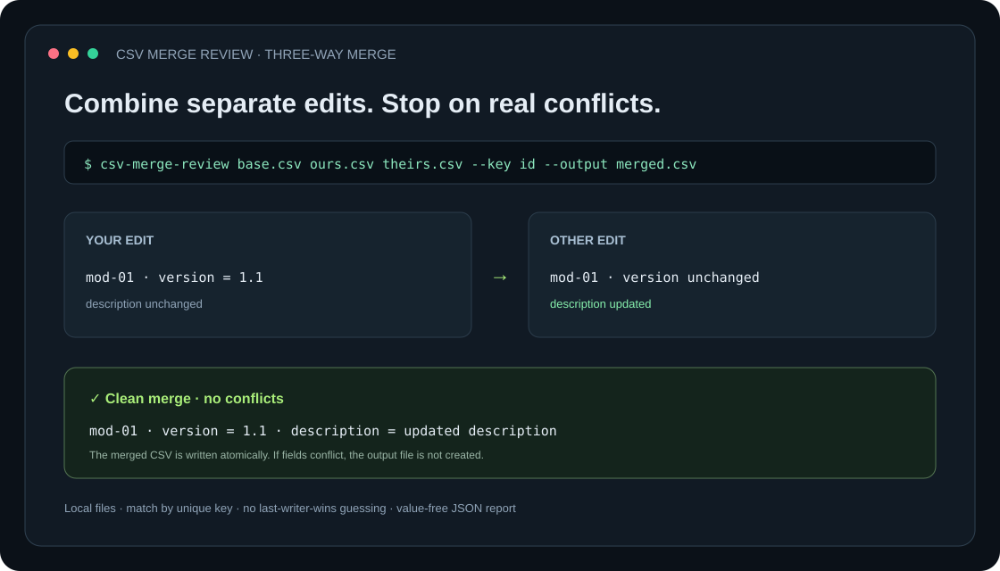

# CSV Merge Review

Safely combine two CSV edits against a shared base. **Disjoint field edits merge automatically; competing edits are reported instead of guessed.** Rows are matched by a unique key, not file position.

[](https://github.com/GhosTnever-lkm/csv-merge-review/actions/workflows/ci.yml) [](https://github.com/GhosTnever-lkm/csv-merge-review/releases) [](LICENSE)



## What it does

- Compares a base file, your edit, and another edit by a unique key column.
- Automatically combines changes to different fields and identical concurrent edits.
- Reports conflicts for different edits to the same field, divergent new rows, and delete-versus-edit cases.
- Refuses to write any merged file if conflicts exist. No “last writer wins” guessing.
- Preserves baseline row order, appends new rows deterministically, and writes quoted UTF-8 CSV.
- Produces a JSON summary without cell values; conflicting keys are included to locate rows, so avoid printing reports with sensitive identifiers into public CI logs.
- In JSON, `mergeable_rows` is `null` whenever any conflict blocks output; it is a row count only for a conflict-free result.
- Processes local files only; default maximum is 10 MiB per input. The output is written atomically and never overwrites an input.

It treats all cells as text and requires matching column sets. It does not infer types, normalize whitespace, or resolve conflicts for you.

## Install and run

Requires Python 3.11 or later; no runtime dependencies.

```bash
python -m venv .venv
# Linux/macOS
. .venv/bin/activate
# Windows PowerShell: .venv\Scripts\Activate.ps1
python -m pip install .
csv-merge-review examples/base.csv examples/ours.csv examples/theirs.csv --key id --output merged.csv
```

To install a published build, download the wheel and its SHA-256 manifest from the [latest release](https://github.com/GhosTnever-lkm/csv-merge-review/releases/latest):

```bash
python -m pip install csv_merge_review-0.1.2-py3-none-any.whl
```

Write a conflict report to stdout; any conflict exits `1` and no merged file is written:

```bash
csv-merge-review base.csv ours.csv theirs.csv --key mod_id --output merged.csv --json-report
```

Exit codes: `0` clean merge, `1` conflicts, `2` invalid input or I/O error.

## Development

```bash
python -m unittest discover -s tests -v
```

Download the versioned source archive from [Releases](https://github.com/GhosTnever-lkm/csv-merge-review/releases/latest).

## ☕ Support / Pro Version

The core is free under MIT; no paid edition is currently offered. For custom data-merge workflows, open a [GitHub issue](https://github.com/GhosTnever-lkm/csv-merge-review/issues) or support the developer via [GitHub Sponsors](https://github.com/sponsors/GhosTnever-lkm).
